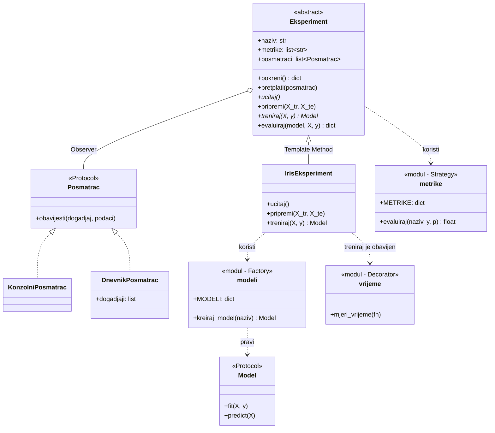

# Mini projekat 2 - mini okvir za ML eksperimente

Program trenira tri modela (linearni, stablo odlučivanja, kNN) na skupu iris i računa metrike.
Usput koristi pet šablona iz 3. i 4. nedjelje.

## Pokretanje

```
cd mini_projekat_2
pip install -r requirements.txt
python main.py
pytest
```

Rezultat (tačnost na test skupu): linearni 0.911, stablo 0.911, knn 0.911.

## Gdje je koji šablon

- **Factory** - `eksperimenti/modeli.py`. Model se pravi po nazivu: `kreiraj_model("knn")`. Modeli su u
  rječniku `MODELI`, a novi se dodaje sa `@registruj_model("naziv")`. Za nepoznat naziv baca `ValueError`.
- **Strategy** - `eksperimenti/metrike.py`. Svaka metrika (tacnost, f1, preciznost) je funkcija istog
  oblika, a bira se iz rječnika `METRIKE`, bez if/elif.
- **Observer** - `eksperimenti/posmatraci.py`. Eksperiment javlja događaje (pocetak, kraj_treninga,
  rezultati) svim pretplaćenim posmatračima. `KonzolniPosmatrac` ispisuje, `DnevnikPosmatrac` pamti.
- **Template Method** - `eksperimenti/eksperiment.py`. `Eksperiment.pokreni()` uvijek ide istim redom:
  ucitaj, pripremi, treniraj, evaluiraj. `IrisEksperiment` mijenja samo korake.
- **Decorator** - `eksperimenti/vrijeme.py`. `@mjeri_vrijeme` na metodi `treniraj` ispisuje koliko je
  trening trajao, a ne mijenja samu metodu.

## Dijagram klasa



## Testovi

14 testova u `tests/test_sabloni.py`: fabrika (pravi dobar model, nepoznat naziv daje grešku), metrike,
dekorator (vraća isti rezultat i čuva ime funkcije), Template Method i Observer preko lažnog
eksperimenta sa lažnim modelom (bez sklearn-a), i na kraju svaki model na pravom iris skupu.

## Rad sa AI

AI asistent (Claude) sam koristila u četiri koraka: za izradu, pa za tri pregleda koda po
upitima iz prezentacija.

### Upit 1 - izrada

> **Uloga:** iskusni Python programer koji poznaje projektne šablone i scikit-learn.
>
> **Zadatak (mini projekat 2, tekst sa slajda):**
> - Factory za modele (npr. linearni, stablo odlučivanja, kNN iz scikit-learn)
> - Strategy za metrike i Observer za praćenje treninga
> - Template Method za tok eksperimenta i Decorator za mjerenje vremena
> - Demonstracija na skupu iris, najmanje pet pytest testova
> - README sa Mermaid dijagramom klasa i opisom upotrebe AI alata
>
> **Konkretno:**
> 1. Factory: funkcija `kreiraj_model(naziv)` za nazive "linearni", "stablo" i "knn". Modeli se
>    upisuju u registar (rječnik), a nepoznat naziv mora dati jasnu grešku.
> 2. Strategy: metrike tačnost i F1 kao funkcije istog potpisa `(y_tacno, y_predvidjeno) -> float`,
>    izbor po nazivu iz rječnika, bez if/elif.
> 3. Observer: eksperiment obavještava pretplaćene posmatrače o događajima (početak, kraj treninga,
>    rezultati). Jedan posmatrač ispisuje u konzolu, drugi pamti događaje.
> 4. Template Method: apstraktna klasa `Eksperiment` sa metodom `pokreni()` koja uvijek ide redom
>    učitaj, pripremi, treniraj, evaluiraj. Podklasa `IrisEksperiment` mijenja samo korake.
> 5. Decorator: `@mjeri_vrijeme` koji ispiše trajanje funkcije i vrati njen rezultat nepromijenjen.
> 6. `main.py` pokreće sva tri modela na skupu iris i ispisuje tabelu rezultata.
> 7. Testovi: za svaki šablon bar jedan, a Template Method i Observer testirati lažnim modelom,
>    bez scikit-learn-a.
>
> **Ograničenja:** type hints, kod prolazi ruff i mypy, bez apstrakcija koje zadatak ne traži.
>
> **Izlaz:** kod po fajlovima, a za svaki šablon kratko objašnjenje: koji problem rješava, kako
> je riješen i šta je posljedica.

### Upit 2 - prepoznavanje šablona (slajd 19, 3. nedjelja)

> Uloga: iskusni softverski arhitekta. Analiziraj priloženi kod.
> 1. Navedi projektne šablone (GoF) koji se već koriste, svjesno ili ne.
> 2. Navedi mjesta gdje bi neki šablon smanjio dupliranje ili olakšao testiranje.
> 3. Za svaki prijedlog navedi korist i cijenu.
> Ograničenje: ne predlaži šablon ako je dovoljna jednostavna funkcija.

Odgovor: pored pet traženih šablona, `@registruj_model` je isti mehanizam kao Decorator (obavija
funkciju i upisuje je u registar), a `Model` i `Posmatrac` su Protocol, pa test može da koristi
lažne objekte. Prijedlozi:
- `KonzolniPosmatrac` ima mali if/else po vrsti događaja. Rječnik obrađivača bi bio Strategy, ali za
  dva slučaja nije vrijedno. **Ostavila sam if/else.**
- `@mjeri_vrijeme` samo ispisuje vrijeme, pa trajanje ne stiže do posmatrača. Moglo bi se slati kao
  događaj, ali bi dekorator onda morao da zna za eksperiment. **Ostavila sam ispis**, jer zadatak
  traži samo mjerenje.
- Fabrika ne prima parametre modela (npr. broj susjeda za kNN). Korist je fleksibilnost, a cijena
  više koda i testova. Za ovaj zadatak nije potrebno, pa **nisam dodala.**

### Upit 3 - poređenje alternativa za metrike (slajd 15, 4. nedjelja)

> Uloga: iskusni softverski inženjer. Za tri metrike (tacnost, f1, preciznost) predloži dva
> pristupa: (a) klase koje implementiraju Strategy, (b) rječnik funkcija. Uporedi ih po
> čitljivosti, testiranju i dužini koda i preporuči jedan za tim od tri programera.

Odgovor: klase daju mjesto za stanje i dodatne metode (npr. naziv, da li je veće bolje), ali je
svaka klasa 4-5 linija za jedan poziv sklearn funkcije. Rječnik funkcija je kraći, svaka metrika
se testira direktno, a nova se dodaje jednim redom. **Izabrala sam rječnik funkcija.**

### Upit 4 - šta je suvišno (vježba sa slajda 16, 4. nedjelja)

> Pogledaj rješenje i reci šta je u njemu suvišno ili složenije nego što treba.

Odgovor: `preciznost` nije tražena (dovoljne su dvije metrike), a svojstvo `DnevnikPosmatrac.nazivi`
se koristi samo u testovima. Oboje je zadržano: treća metrika bolje pokazuje Strategy, a `nazivi`
čini testove čitljivijim. Ništa drugo nije označeno kao suvišno.

### Ispravke koda koji je AI napisao
- mypy je javio da funkcije u fabrici vraćaju `Any` jer scikit-learn nema tipove. Dodata je
  linija `model: Model = ...` prije `return`.
- ruff je javio da se u Pythonu 3.12 dekorator piše `def mjeri_vrijeme[**P, R](...)` umjesto
  sa `ParamSpec` i `TypeVar`, i dvije predugačke linije u testovima.
- Dekorator je na `IrisEksperiment.treniraj`, a ne na apstraktnoj metodi u `Eksperiment`, jer se
  dekorator sa osnovne klase gubi kada podklasa prepiše metodu.
- Provjerila sam da se skaler uči samo na trening podacima, da test podaci ostanu neviđeni.
- U Actions fajlu sam imala grešku u uvlačenju (YAML), ispravljena je.
